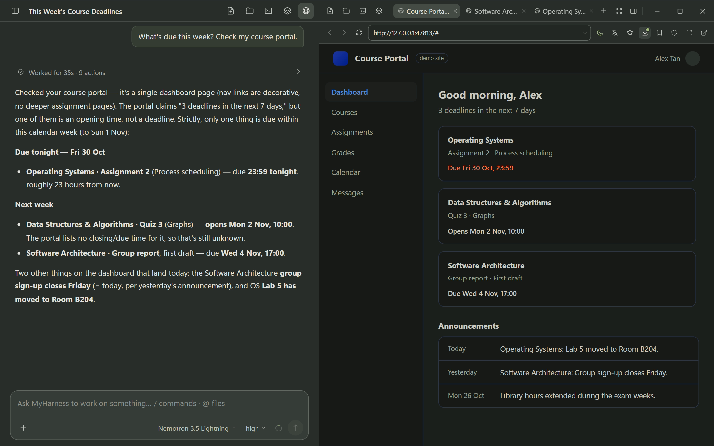
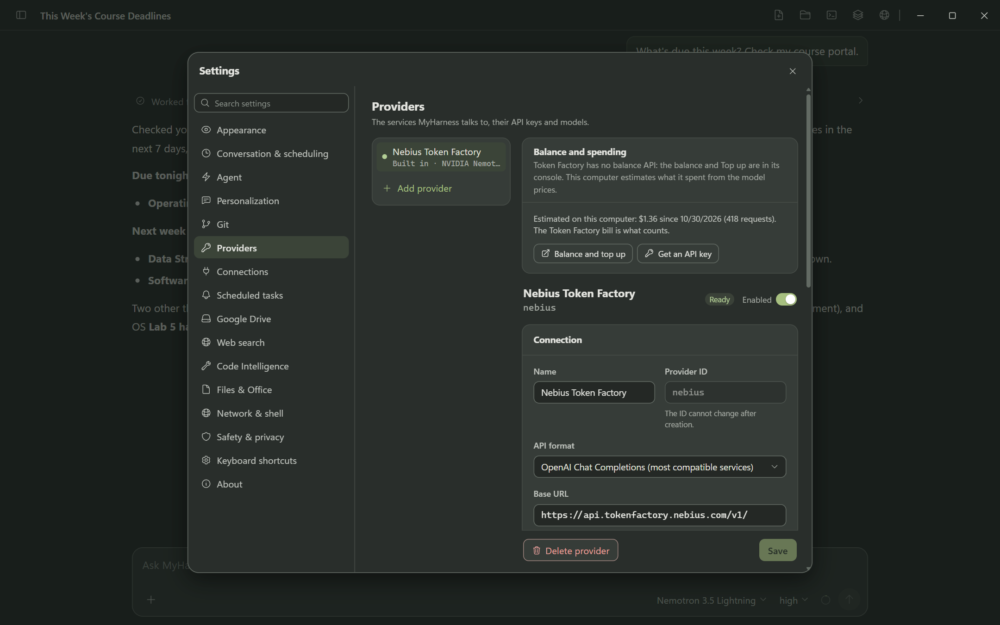

# MyHarness

[English](README.md) | [简体中文](README.zh-CN.md)

[](LICENSE)

MyHarness is a personal AI for your Windows PC that works inside the websites you're already signed into. It remembers what matters to you, keeps chats and schedules in sync across your computers, and still handles coding when you need it. Out of the box it runs NVIDIA Nemotron and DeepSeek V4.1 Flash on Nebius Token Factory: paste one API key and every job gets its model.

**[Download for Windows](https://github.com/h3327725338-star/MyHarness/releases/latest)** · [Demo video](https://youtu.be/0QUhR5p5z0c) · [Evaluation: real runs and results](docs/evaluation/README.md) · [Judge testing guide](docs/JUDGE_TESTING.md) · [Known limitations](docs/JUDGE_TESTING.md#known-limitations)



**Measured on real runs, with the main chat on NVIDIA Nemotron 3.5 Lightning:** 196 of 200 random SimpleQA questions answered correctly with web search (Google + Tavily), 111 of 120 memory questions answered correctly in brand-new chats, 8 of 9 tasks done on a signed-in website, and 15 of 15 image questions answered correctly through Nemotron 3.5 Super VL. [Methods, every failure and how to repeat the runs](docs/evaluation/README.md).

## Why MyHarness

AI assistants have become smart, but in daily use they still leave the legwork to you. These are the gaps MyHarness was built to close:

- **They can't reach the real web.** Ask about a page and many assistants say they can't open it, or answer from a few search snippets; a wide search that actually reads the sources is rare. *MyHarness searches several engines, reads the full pages, and opens a blocked page in a real browser.*
- **They can't use your accounts.** Your course portal, inbox, GitHub and cloud console sit behind sign-ins, and handing an agent your passwords is not an option. *MyHarness works in the browser you're already signed into. Saved passwords are filled in by the app and never reach the model, and sign-ins and human checks are handed back to you.*
- **They only work when you ask.** Nothing happens at 8:00 unless you open the chat and type. *MyHarness runs reminders, agent tasks and emails on a schedule, keeps running from the tray, and can start with Windows.*
- **They forget you when you switch computers.** Your history and context stay on one machine or one account; move from the desktop at home to the laptop you carry and you start from zero. *MyHarness syncs memories, everyday chats, schedules, bookmarks and prompts through your own Google Drive.*
- **One assistant fits nobody.** A course, a job and a side project each need their own instructions, memory and documents, but most assistants offer one global prompt at best. *MyHarness gives each part of your life a workspace with its own instructions, memory and document library.*
- **Long work falls apart.** Long chats overflow the context, and what you settled last week is gone unless you paste it in again. *MyHarness compacts long chats, continues them in a fresh chat with a handoff summary, and looks up your earlier chats when they matter.*
- **The small things feel rough.** Quoting part of an answer for a follow-up, translating a word or a sentence, or getting back to the line you quoted takes more steps than it should. *In MyHarness you select text to quote it or translate it in place, and a quote jumps back to its source.*
- **Your data sits on someone else's server.** Chats, memories and keys end up in a cloud you don't control. *MyHarness keeps them on your PC, with no MyHarness server; if you turn on sync, the copy goes to your own Google Drive.*

MyHarness started as one computer-science student's fix for these problems, built around a real week of course portals, deadlines and two PCs.

## What it does

**In the real web**

- **Works in the sites you're signed into.** A real Chromium browser is built in, with one persistent profile, so your sign-ins survive restarts. The agent opens its own background tabs, reads whole pages, clicks, types and downloads files, while you keep browsing in yours.
- **Bookmarks it understands.** Every bookmark carries a one-line note of what you use the site for, written by you or by a helper model, so "check what's due this week" reaches the right portal without you naming it.
- **Reads real pages, not just snippets.** Web search runs on Tavily (no key needed) and Google, then reads the full text of the top results. When a site or search engine blocks a plain request, MyHarness opens it in a real browser instead of giving up.
- **Stops where only you should act.** Saved passwords are filled in by the app itself and never reach the model. When a page needs your sign-in or a human check, a request bar appears on that tab; the agent waits and carries on once you're done. On CAPTCHA and bot-check pages its clicks and typing are refused.

**Memory and your profile**

- **Memory at three levels.** Global memories go everywhere with you, each workspace keeps its own, and each chat keeps its own notes, so one course's details don't spill into another's chats.
- **Saves without being asked.** After each task, Auto Memory picks out what is worth keeping and files it at the right level. You can still say "remember this" or "forget that" at any time.
- **Builds your profile.** A resident user profile grows out of your conversations and goes with every turn, so the assistant knows your goals, habits and preferences from the first message.
- **Keeps itself tidy.** In the background, MyHarness merges related memories, settles contradictions in favour of the newer fact and keeps every replaced version in an archive, without asking you to approve each change.
- **Recalls within a budget.** Memories are recalled on every turn within a fixed budget, so a large profile never crowds out the conversation.

**Conversations that connect**

- **Many chats at once.** Several chats can run at the same time without blocking each other, each with its own task and tools.
- **Chats that know each other.** When a question touches an earlier conversation, the assistant looks it up by itself and links its answer back to the exact message it used.
- **Long work keeps going.** Long chats are compacted to stay within the context window, and any chat can continue in a fresh one that starts from a handoff summary.
- **Rewind or fork.** Rewind to any message, or fork a new chat from it while the original stays as it was.
- **Steer while it works.** Send a message while a task is running, to steer it on the spot or queue the next step.
- **Find and keep.** Search and filter your chats, archive old ones, and export a chat as a self-contained HTML page.

**Workspaces and personalization**

- **A workspace for each part of your life.** General-mode workspaces, for example one per course or project, each have their own instructions, memory and document library.
- **Your own prompts.** A personal prompt for each mode, a list of saved prompts to reuse in any chat, and skills and prompt templates for more.
- **Follows you to your other PCs.** Memories at every level, your profile, everyday (General-mode) chats with their branches, schedules, bookmarks, prompts and drafts sync through your own Google Drive, and changes made on two PCs are merged instead of overwritten.

**Works on its own**

- **Runs on a schedule.** Reminders, agent tasks ("every weekday at 8:00, check my portal and inbox and note new deadlines") and emails sent exactly on time. They run while MyHarness is open, including from the tray, and it can start with Windows.
- **Keeps you posted.** A card tells you when a task starts, finishes or fails, with a system notification and an optional sound when you're in another window.
- **Handles email and GitHub.** Gmail and Outlook, through their API or the webmail page you're already signed into; GitHub through the sign-in already on your PC.

**Big jobs, in parallel**

- **Sub-agents that split the work.** For research or other big jobs, the assistant hands parts to sub-agents that run in parallel (on Nemotron 3 Ultra by default), and you can stop any one of them. Staged workflows handle longer jobs step by step.

**Polished for daily use**

- **Quote and ask.** Select any part of an answer to quote it in your next message; a quote in a sent message jumps back to the original text.
- **Translate anything you select.** In the chat, files or panels, a translation card opens in place, and a single word gets a dictionary entry with UK and US pronunciation.
- **Sees images and opens your files.** Drop in files and images; images are read by a vision model, and PDFs and images open in the side panel next to the chat.
- **A browser that comes first.** Full-screen browsing keeps the chat one edge away, websites follow the app's dark mode, and each site keeps its own zoom.
- **Made to feel like yours.** Three color themes, an English or Chinese interface, and keyboard shortcuts for the common actions.

**Your models, your data**

- **A model for every job.** Sub-agents, memory, chat naming, translation, vision, schedules and the other helper jobs can each have their own model and thinking level, and one Nebius Token Factory key sets them all up.
- **Your data stays on your PC.** The interface listens only on `127.0.0.1`. Chats, memories, settings and keys live in `%USERPROFILE%\.myharness` (a source build run from a checkout keeps chats and memories in that checkout's `data` folder), and there is no MyHarness server. Model calls go to the Provider you choose (Nebius Token Factory by default), and sync goes through your own Google Drive. Sync is not end-to-end encrypted, except the browser's sign-ins, which are sealed with your passphrase before upload.

**Still writes code**

- **Coding mode** works inside a repository with Git, worktrees, per-turn change review and sub-agents.

> Status: usable today on Windows x64, from the desktop app or a source checkout. Nebius Token Factory is offered ready-made (Settings → Providers → **Nebius Token Factory**: paste a key, DeepSeek V4.1 Flash and the Nemotron models are assigned to each job); any other OpenAI-, Anthropic-, Gemini- or Mistral-compatible Provider can be added by hand. The verified boundaries are listed in [PROJECT_STATUS.md](PROJECT_STATUS.md).

## NVIDIA Nemotron on Nebius Token Factory

The built-in model backend is **[Nebius Token Factory](https://api.tokenfactory.nebius.com/v1/)**, serving **NVIDIA Nemotron** and DeepSeek V4.1 Flash. Settings → Providers opens on **Nebius Token Factory**. **Get an API key** opens the Token Factory console in the built-in browser; the key pasted into the strip above that page (or into Settings) is checked against the account's model list, written as an ordinary `openai-completions` Provider in `models.json`, and every job that has no model of its own gets its model:

| Model | Jobs |
|-------|------|
| DeepSeek V4.1 Flash 1017 | main model, commit descriptions (Ultra when the account has no DeepSeek) |
| Nemotron 3 Ultra | sub-agents, conversation naming, translation |
| Nemotron 3.5 Lightning | compaction, fallback, Auto Memory, hand-off notes, bookmark notes, scheduled tasks, worktree naming, branch summaries |
| Nemotron 3.5 Super VL | vision assistant |

**Why Token Factory.** Nebius Token Factory turned out to be a great home for a personal assistant. One OpenAI-compatible API serves a wide catalog of open models, so a single key let us pick, for every job, the model with the best value and the best fit, and each NVIDIA model has a job where it shines:

- **Nemotron 3 Ultra, the deep thinker:** runs the sub-agents that research and work in parallel, and names and translates.
- **Nemotron 3.5 Lightning, the quick hand:** takes the many small background jobs that run all day (memory, schedules, bookmark notes, summaries and compaction).
- **Nemotron 3.5 Super VL, the eyes:** reads screenshots and images and reports what it sees to the main model.
- **Room for long work:** every built-in model has a context window of about one million tokens, and its requests take the same OpenAI-compatible path as every other Provider.

The main chat runs on DeepSeek V4.1 Flash because the Nemotron models had problems calling tools as the main agent in testing. They answer quickly, though, which suits the sub-agent, naming, translation, background and image work they do. The main model, sub-agents and commit descriptions are set to their model's highest thinking level (max for DeepSeek, high for Ultra). Each Nemotron model offers only the thinking levels NVIDIA documents for it: Ultra has off, medium and high; Lightning has off and high. DeepSeek offers off, low, high and max.

Token Factory has no balance API, so the Nebius card links to the console for the balance and top-up, shows what this computer estimates it has spent from the model prices, and a request refused with HTTP 402 or an error that names the balance is explained as a balance problem.



| Model ID | Context | Max output | Added by |
|----------|---------|------------|----------|
| `deepseek-ai/DeepSeek-V4.1-Flash-1017` | 1,048,576 | not published (65,536 is set) | the built-in setup and the example file |
| `nvidia/Nemotron-3-Ultra-550b-a55b` | 1,048,576 | 65,536 | the built-in setup and the example file |
| `nvidia/Nemotron-3_5-Lightning` | 1,048,576 | 65,536 | the built-in setup and the example file |
| `nvidia/Nemotron-3.5-Super-VL` | 1,048,576 | not published (4,096 is set) | the built-in setup and the example file |
| `nvidia/nemotron-3-super-120b-a12b` | 262,144 | 65,536 | the example file only |

The built-in setup takes each ID as the account's model list spells it. Earlier versions also added Nemotron 3 Nano for naming and translation; Ultra does that now, and a Nano entry that is already there is left as it is. DeepSeek V4.1 Flash 1017 and Super-VL accept images; with the vision assistant on (the default), images go to Super-VL and the main model gets its report. The Nemotron text models are text-only. Verified on 2026-10-25: a generated test image carrying a random string plus a red circle and a blue rectangle was read correctly in about 1.3 s. Give it a few thousand output tokens — its reasoning runs before the answer.


Without the UI, the same Provider can come from one file:

```powershell
# 1. copy the ready-made Provider entry
Copy-Item packages\coding-agent\docs\examples\nebius-models.json "$env:USERPROFILE\.myharness\agent\models.json"

# 2. provide the Token Factory key through the environment
$env:NEBIUS_TOKEN_FACTORY_API_KEY = "<your-token-factory-key>"

# 3. start the app, then pick "Nemotron 3 Ultra" in /model
.\dev-desktop.cmd
```

It can also be created by hand in Settings → **Providers** → **Add provider** with Base URL `https://api.tokenfactory.nebius.com/v1/` and API type OpenAI Chat Completions. The text models of the example declare `text` input and offer only their documented thinking levels, sent as `reasoning_effort` (Ultra: off / medium / high; Super: off / low / high; Lightning: off / high; `off` is sent as `none`); Super-VL declares `text` and `image` input, is sent no `reasoning_effort` and always reasons.

- Full setup, verification steps and limits: [NVIDIA Nemotron on Nebius Token Factory](packages/coding-agent/docs/nebius-token-factory.md).
- Ready-to-copy configuration: [`examples/nebius-models.json`](packages/coding-agent/docs/examples/nebius-models.json).

## Memory, user profile and cross-device sync

- A resident user profile (`global/用户画像`) is sent on every turn instead of being ranked against the query, with a layered recall budget (profile slot, catalog slot, dynamic cards) so a large profile cannot crowd out the rest of the context.
- Three memory scopes — global, workspace and session — plus archives and a pending quarantine, with tools to search, read, write, delete and claim an entry. Background maintenance folds new material into the profile and merges related memories without per-item approval.
- MyHarness talks to the Google Drive API directly and syncs all memory scopes (archives, pending entries, the profile), General-mode workspaces and chats with their branches and handoff summaries, session attachments and artifacts, workspace library sources, drafts, the General-mode personal prompt, saved prompts (My prompts), scheduled tasks, and the built-in browser's bookmarks, new-tab shortcuts and site settings; the browser's sign-ins and saved passwords travel only when a sync passphrase is set, sealed with it on the device before upload.
- It does not sync API keys, OAuth tokens, trust decisions, tool permissions, locks, running tasks, Coding-mode chats or repositories, or other Web UI preferences.
- Merging uses a stable key plus a per-device version vector: memories merge three-way against the last version both devices agreed on, chats merge by entry id so both branches survive, and a conflict that cannot be merged keeps the local version and saves the other as a recoverable copy listed in Settings. Nothing arriving from Drive can grant Project Trust or execute a command.
- Boundary: sync talks to the Drive API directly. Besides the in-memory-transport tests, the maintainer has run it for real across at least four PCs. Sync stops when the app quits, and apart from the browser's sealed sign-in vault there is no end-to-end encryption. See [Google Drive sync](packages/coding-agent/docs/google-drive-sync.md).

## Quick Start (Windows)

**Installer.** Download `MyHarness-Setup-<version>.exe` from the MyHarness release on the [Releases](https://github.com/h3327725338-star/MyHarness/releases) page and run it.
- It is not code-signed, so SmartScreen asks first: click **More info**, then **Run anyway**.
- Choose **Only for me** to install without administrator rights.
- Uninstalling keeps your data in `%USERPROFILE%\.myharness`.

**From source.** Requirements:

- Windows 10 or 11, x64;
- Node.js `>=22.19.0`;
- Git for Windows if you want to use the `bash` tool;
- a model Provider key: Nebius Token Factory is built in, and other Providers can be added by hand.

```powershell
git clone https://github.com/h3327725338-star/MyHarness.git
cd MyHarness
npm.cmd install --ignore-scripts
npm.cmd run build
.\dev-desktop.cmd
```

`dev-desktop.cmd` builds and starts the Electron desktop app, which is the normal way to use MyHarness. To run the sources from a command line instead, use `node --import ./scripts/dev-fast-loader.mjs ./packages/coding-agent/src/web.ts` from the repository root; it opens no browser and prints the actual address as `MyHarness Web UI: <url>`.

After startup, the start screen links to the built-in Nebius Token Factory setup (Settings → Providers). Paste a Token Factory key there and DeepSeek V4.1 Flash and the Nemotron models are set up. Other Providers are described in [Providers](packages/coding-agent/docs/providers.md) and [Settings](packages/coding-agent/docs/settings.md).

To check that the Web source entry can start without a Provider credential:

```powershell
node --import ./scripts/dev-fast-loader.mjs ./packages/coding-agent/src/web.ts --help
```

This smoke check does not prove that an external Provider, OAuth flow, Web Search service, or real model conversation works.

## Evaluating this project

[Evaluation: real runs on NVIDIA Nemotron](docs/evaluation/README.md) reports what MyHarness did on web search, signed-in website tasks, human-check handoff, memory, images, sub-agents and schedules: the setup, every failure with its cause, the cost at list prices, and the scripts to repeat the runs.

[Judge testing guide](docs/JUDGE_TESTING.md) covers installing (or building from source), attaching Nebius Token Factory credentials, a five-minute test script, what to inspect in the source, and the known limitations.

## For developers

Under the hood, an Electron shell runs a local-only Web UI (`127.0.0.1`) and a shared backend that connects the model Provider to your files, shell commands, a built-in browser, tools and resumable sessions.

- **Code collaboration**: file, shell, PowerShell, editing, writing, Symbols, Git, and GitHub workflows exposed through the Coding Agent product layer.
- **Entry points**: a local browser **Web UI** (`myharness`, loopback only), packaged as a Windows desktop app, plus a Node.js SDK for in-process integrations. Terminal Interactive, Print and JSON modes have been removed; the Web Terminal panel is retained.
- **Conversations and changes**: resumable sessions, per-turn change review, branch summaries, and context compaction over long sessions.
- **Project context**: project trust, `AGENTS.md` / `CLAUDE.md` context files, Workspace and Session management, Git integration.
- **Extensibility**: TypeScript extensions, skills, prompt templates, themes, custom Providers, and MyHarness packages.
- **Code Intelligence**: semantic Symbols navigation through optional Windows language-server modules installed per language. The `symbols` tool is disabled by default and can be enabled with `codeIntelligence.symbolsEnabled`; changes take effect after restart.
- **Two modes, one backend**: Coding mode works inside a repository; General mode handles research, writing and everyday tasks with per-workspace instructions, workspace memory and a document library. Chat lists, drafts and color themes are kept per mode.
- **A browser the agent can drive**: the right panel hosts real Chromium tabs (`WebContentsView` on desktop, one persistent partition so logins survive restarts); the `workspace` tool navigates, clicks, types, reads the page or its accessibility tree, runs page scripts, screenshots, downloads files and inspects requests.
- **Multi-agent work**: `agent` (foreground and background batches), `workflow` (staged) and `ultracode` (multi-pass) dispatch, with a three-level activity bar, per-agent stop and explicit terminal states; `agent_tasks` lets the main agent list and stop its own dispatches.
- **Per-role model binding**: the main model is picked in the composer's model menu, and Settings → Agent binds a Provider, model and thinking level for each helper role — sub-agents, Auto Memory, chat naming, compaction, branch and handoff summaries, commit descriptions, worktree naming, translation, vision, and a fallback model. A role set to “Use the main model” follows the main chat's model and effort; for the fallback model that means no fallback.
- **Web search on by default**: Tavily and Google. Without a key Tavily answers through its free keyless access (rate limited by Tavily); Settings → Web search has a **Get a free key** link for 1,000 searches a month. Bing, DuckDuckGo and Brave can be added, and an engine that blocks the lightweight request falls back to a browser.
- **Optional extras**: TypeScript extensions, skills and prompt templates.

The source and status documents deliberately separate implemented contracts, configured runtime behavior, and machine- or credential-dependent validation.

## Documentation

- [Coding Agent documentation index](packages/coding-agent/docs/index.md)
- [Quickstart](packages/coding-agent/docs/quickstart.md)
- [Usage and Web startup](packages/coding-agent/docs/usage.md)
- [Providers and models](packages/coding-agent/docs/providers.md)
- [NVIDIA Nemotron on Nebius Token Factory](packages/coding-agent/docs/nebius-token-factory.md)
- [Google Drive sync](packages/coding-agent/docs/google-drive-sync.md)
- [Windows setup](packages/coding-agent/docs/windows.md)
- [Project status and validation boundaries](PROJECT_STATUS.md)
- [Architecture and development handbook](ARCHITECTURE_AND_DEVELOPMENT.md)
- [Development guide](packages/coding-agent/docs/development.md)
- [Source module map](packages/coding-agent/docs/source-modules.md)
- [Storage and data boundaries](docs/STORAGE.md)
- [Maintenance guide](MAINTENANCE.md)
- [GitHub automation](docs/maintenance/github-automation.md)
- [Contributing](CONTRIBUTING.md)
- [Security policy](SECURITY.md)
- [Documentation map](DOCUMENTATION_INDEX.md)
- [简体中文 README](README.zh-CN.md)

## Development and contribution

From the repository root:

```powershell
npm.cmd run check
npm.cmd test
npm.cmd run audit:release
```

`npm.cmd run check` runs Biome with write enabled and can modify formatted files. See [CONTRIBUTING.md](CONTRIBUTING.md) for the supported checks, release/privacy boundaries, and pull-request expectations.

## Acknowledgements

MyHarness began as a fork of [pi-mono](https://github.com/badlogic/pi-mono) by Mario Zechner (MIT) and has since been extensively rewritten and extended. See [THIRD_PARTY_NOTICES.md](THIRD_PARTY_NOTICES.md) for the original license.

## License

MyHarness-owned work is distributed under the [Apache License 2.0](LICENSE). Inherited and third-party components retain their own licenses, copyrights, and attributions; see [NOTICE](NOTICE) and [THIRD_PARTY_NOTICES.md](THIRD_PARTY_NOTICES.md).
