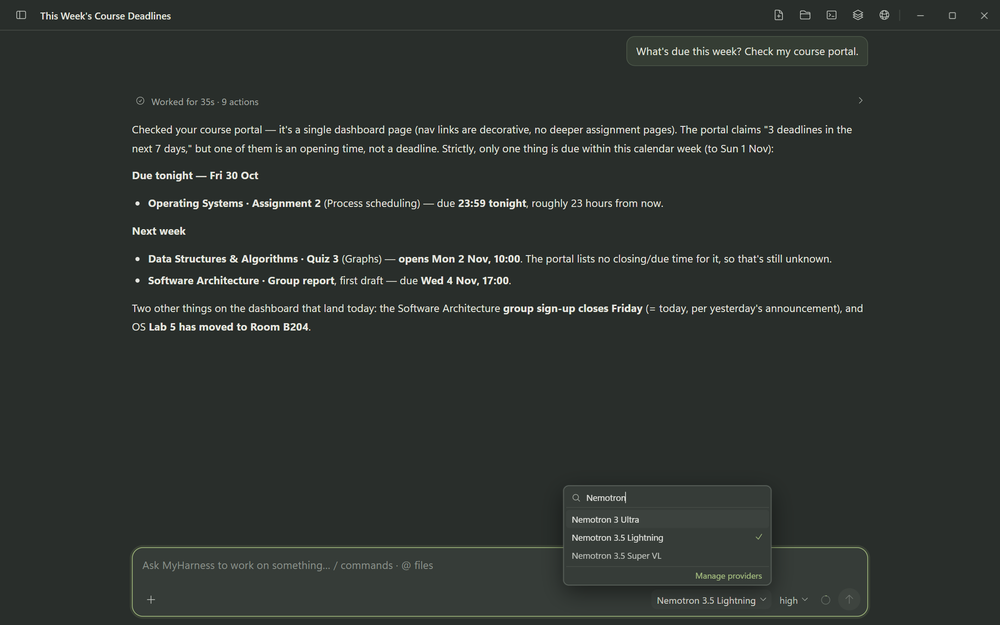

# MyHarness

[English](README.md) | [简体中文](README.zh-CN.md)

[](LICENSE)

MyHarness is a personal AI for your Windows PC that works inside the websites you're already signed into. It remembers what matters to you, keeps chats and schedules in sync across your computers, and still handles coding when you need it. Out of the box it runs NVIDIA Nemotron models on Nebius Token Factory: paste one API key and every role is set up.

Under the hood, an Electron shell runs a local-only Web UI (`127.0.0.1`) and a shared backend that connects the model Provider to your files, shell commands, a built-in browser, tools and resumable sessions.

> Status: usable today on Windows x64, from the desktop app or a source checkout. Nebius Token Factory is offered ready-made (Settings → Providers → **Nebius Token Factory**: paste a key, the Nemotron models are assigned to each job); any other OpenAI-, Anthropic-, Gemini- or Mistral-compatible Provider can be added by hand. The verified boundaries are listed in [PROJECT_STATUS.md](PROJECT_STATUS.md).

## Core capabilities

- **Code collaboration**: file, shell, PowerShell, editing, writing, Symbols, Git, and GitHub workflows exposed through the Coding Agent product layer.
- **Entry points**: a local browser **Web UI** (`myharness`, loopback only), packaged as a Windows desktop app, plus a Node.js SDK for in-process integrations. Terminal Interactive, Print and JSON modes have been removed; the Web Terminal panel is retained.
- **Conversations and changes**: resumable sessions, per-turn change review, branch summaries, and context compaction over long sessions.
- **Project context**: project trust, `AGENTS.md` / `CLAUDE.md` context files, Workspace and Session management, Git integration.
- **Extensibility**: TypeScript extensions, skills, prompt templates, themes, custom Providers, and MyHarness packages.
- **Code Intelligence**: semantic Symbols navigation through optional Windows language-server modules installed per language. The `symbols` tool is disabled by default and can be enabled with `codeIntelligence.symbolsEnabled`; changes take effect after restart.
- **Two modes, one backend**: Coding mode works inside a repository; General mode handles research, writing and everyday tasks with per-workspace instructions, workspace memory and a document library. Chat lists, drafts and color themes are kept per mode.
- **A browser the agent can drive**: the right panel hosts real Chromium tabs (`WebContentsView` on desktop, one persistent partition so logins survive restarts); the `workspace` tool navigates, clicks, types, reads the page or its accessibility tree, runs page scripts, screenshots, downloads files and inspects requests.
- **Multi-agent work**: `agent` (foreground and background batches), `workflow` (staged) and `ultracode` (multi-pass) dispatch, with a three-level activity bar, per-agent stop and explicit terminal states; `agent_tasks` lets the main agent list and stop its own dispatches.
- **Per-role model binding**: the main model is picked in the composer's model menu, and Settings → Agent binds a Provider, model and thinking level for each helper role — sub-agents, Auto Memory, chat naming, compaction, branch and handoff summaries, commit descriptions, worktree naming, translation, vision, and a fallback model. A role set to “Use the main model” follows the main chat's model and effort; for the fallback model that means no fallback.
- **Web search on by default**: Tavily and Google. Without a key Tavily answers through its free keyless access (rate limited by Tavily); Settings → Web search has a **Get a free key** link for 1,000 searches a month. Bing, DuckDuckGo and Brave can be added, and an engine that blocks the lightweight request falls back to a browser.
- **Optional extras**: TypeScript extensions, skills and prompt templates.

The source and status documents deliberately separate implemented contracts, configured runtime behavior, and machine- or credential-dependent validation.

## NVIDIA Nemotron on Nebius Token Factory

The reference model backend for this project is **NVIDIA Nemotron served by [Nebius Token Factory](https://api.tokenfactory.nebius.com/v1/)**, and it is built in: Settings → Providers opens on **Nebius Token Factory**. **Get an API key** opens the Token Factory console in the built-in browser; the key pasted into the strip above that page (or into Settings) is checked against the account's model list, written as an ordinary `openai-completions` Provider in `models.json`, and every job that has no model of its own gets its Nemotron model:

| Model | Jobs |
|-------|------|
| Nemotron 3 Ultra | main model, commit descriptions |
| Nemotron 3.5 Lightning | sub-agents, compaction, fallback, Auto Memory, hand-off notes, bookmark notes, scheduled tasks, worktree naming, branch summaries |
| Nemotron 3 Nano | conversation naming, translation (Lightning when the account has no Nano) |
| Nemotron 3.5 Super VL | vision assistant |

The main model, sub-agents and commit descriptions are set to their model's highest thinking level. Each model offers only the thinking levels NVIDIA documents for it: Ultra has off, medium and high; Lightning has off and high.

Token Factory has no balance API, so the Nebius card links to the console for the balance and top-up, shows what this computer estimates it has spent from the model prices, and a request refused with HTTP 402 or an error that names the balance is explained as a balance problem.


| Model ID | Context | Max output | Added by |
|----------|---------|------------|----------|
| `nvidia/Nemotron-3-Ultra-550b-a55b` | 1,048,576 | 65,536 | the built-in setup and the example file |
| `nvidia/Nemotron-3_5-Lightning` | 1,048,576 | 65,536 | the built-in setup and the example file |
| `nvidia/Nemotron-3.5-Super-VL` | 1,048,576 | not published (4,096 is set) | the built-in setup and the example file |
| `nvidia/NVIDIA-Nemotron-3-Nano-30B-A3B` | 262,144 | 16,384 | the built-in setup, only when the account's model list has it |
| `nvidia/nemotron-3-super-120b-a12b` | 262,144 | 65,536 | the example file only |

The built-in setup takes each ID as the account's model list spells it. The Nano entry is the only one not yet confirmed on Token Factory. Only Super-VL accepts images; the others are text-only. Verified on 2026-10-25: a generated test image carrying a random string plus a red circle and a blue rectangle was read correctly in about 1.3 s. Give it a few thousand output tokens — its reasoning runs before the answer.



Without the UI, the same Provider can come from one file:

```powershell
# 1. copy the ready-made Provider entry
Copy-Item packages\coding-agent\docs\examples\nebius-models.json "$env:USERPROFILE\.myharness\agent\models.json"

# 2. provide the Token Factory key through the environment
$env:NEBIUS_TOKEN_FACTORY_API_KEY = "<your-token-factory-key>"

# 3. start the app, then pick "Nemotron 3 Ultra" in /model
.\dev-desktop.cmd
```

It can also be created by hand in Settings → **Providers** → **Add provider** with Base URL `https://api.tokenfactory.nebius.com/v1/` and API type OpenAI Chat Completions. The text models of the example declare `text` input and offer only their documented thinking levels, sent as `reasoning_effort` (Ultra: off / medium / high; Super: off / low / high; Lightning: off / high; `off` is sent as `none`); Super-VL declares `text` and `image` input, is sent no `reasoning_effort` and always reasons.

- Full setup, verification steps and limits: [NVIDIA Nemotron on Nebius Token Factory](packages/coding-agent/docs/nebius-token-factory.md).
- Ready-to-copy configuration: [`examples/nebius-models.json`](packages/coding-agent/docs/examples/nebius-models.json).

## Memory, user profile and cross-device sync

- A resident user profile (`global/用户画像`) is sent on every turn instead of being ranked against the query, with a layered recall budget (profile slot, catalog slot, dynamic cards) so a large profile cannot crowd out the rest of the context.
- Three memory scopes — global, workspace and session — plus archives and a pending quarantine, with tools to search, read, write, delete and claim an entry. Background maintenance folds new material into the profile and merges related memories without per-item approval.
- MyHarness talks to the Google Drive API directly and syncs all memory scopes (archives, pending entries, the profile), General-mode workspaces and chats with their branches and handoff summaries, session attachments and artifacts, workspace library sources, drafts, the General-mode personal prompt, saved prompts (My prompts), and the built-in browser's bookmarks, new-tab shortcuts and site settings; the browser's sign-ins and saved passwords travel only when a sync passphrase is set, sealed with it on the device before upload.
- It does not sync API keys, OAuth tokens, trust decisions, tool permissions, locks, running tasks, Coding-mode chats or repositories, or other Web UI preferences.
- Merging uses a stable key plus a per-device version vector: memories merge three-way against the last version both devices agreed on, chats merge by entry id so both branches survive, and a conflict that cannot be merged keeps the local version and saves the other as a recoverable copy listed in Settings. Nothing arriving from Drive can grant Project Trust or execute a command.
- Boundary: this is implemented against the Drive API and covered by in-memory-transport tests; a real two-machine Google run has not been executed here. Sync stops when the app quits, and apart from the browser's sealed sign-in vault there is no end-to-end encryption. See [Google Drive sync](packages/coding-agent/docs/google-drive-sync.md).

## Quick Start (Windows)

**Installer.** Download `MyHarness-Setup-<version>.exe` from the MyHarness release on the [Releases](https://github.com/h3327725338-star/MyHarness/releases) page and run it.
- It is not code-signed, so SmartScreen asks first: click **More info**, then **Run anyway**.
- Choose **Only for me** to install without administrator rights.
- Uninstalling keeps your data in `%USERPROFILE%\.myharness`.

**From source.** Requirements:

- Windows 10 or 11, x64;
- Node.js `>=22.19.0`;
- Git for Windows if you want to use the `bash` tool;
- a model Provider key: Nebius Token Factory is built in, and other Providers can be added by hand.

```powershell
git clone https://github.com/h3327725338-star/MyHarness.git
cd MyHarness
npm.cmd install --ignore-scripts
npm.cmd run build
.\dev-desktop.cmd
```

`dev-desktop.cmd` builds and starts the Electron desktop app, which is the normal way to use MyHarness. To run the sources from a command line instead, use `node --import ./scripts/dev-fast-loader.mjs ./packages/coding-agent/src/web.ts` from the repository root; it opens no browser and prints the actual address as `MyHarness Web UI: <url>`.

After startup, the start screen links to the built-in Nebius Token Factory setup (Settings → Providers). Paste a Token Factory key there and the Nemotron models are set up. Other Providers are described in [Providers](packages/coding-agent/docs/providers.md) and [Settings](packages/coding-agent/docs/settings.md).

To check that the Web source entry can start without a Provider credential:

```powershell
node --import ./scripts/dev-fast-loader.mjs ./packages/coding-agent/src/web.ts --help
```

This smoke check does not prove that an external Provider, OAuth flow, Web Search service, or real model conversation works.

## Evaluating this project

[Judge testing guide](docs/JUDGE_TESTING.md) covers installing (or building from source), attaching Nebius Token Factory credentials, a five-minute test script, what to inspect in the source, and the known limitations.

## Documentation

- [Coding Agent documentation index](packages/coding-agent/docs/index.md)
- [Quickstart](packages/coding-agent/docs/quickstart.md)
- [Usage and Web startup](packages/coding-agent/docs/usage.md)
- [Providers and models](packages/coding-agent/docs/providers.md)
- [NVIDIA Nemotron on Nebius Token Factory](packages/coding-agent/docs/nebius-token-factory.md)
- [Google Drive sync](packages/coding-agent/docs/google-drive-sync.md)
- [Windows setup](packages/coding-agent/docs/windows.md)
- [Project status and validation boundaries](PROJECT_STATUS.md)
- [Architecture and development handbook](ARCHITECTURE_AND_DEVELOPMENT.md)
- [Development guide](packages/coding-agent/docs/development.md)
- [Source module map](packages/coding-agent/docs/source-modules.md)
- [Storage and data boundaries](docs/STORAGE.md)
- [Maintenance guide](MAINTENANCE.md)
- [GitHub automation](docs/maintenance/github-automation.md)
- [Contributing](CONTRIBUTING.md)
- [Security policy](SECURITY.md)
- [Documentation map](DOCUMENTATION_INDEX.md)
- [简体中文 README](README.zh-CN.md)

## Development and contribution

From the repository root:

```powershell
npm.cmd run check
npm.cmd test
npm.cmd run audit:release
```

`npm.cmd run check` runs Biome with write enabled and can modify formatted files. See [CONTRIBUTING.md](CONTRIBUTING.md) for the supported checks, release/privacy boundaries, and pull-request expectations.

## Acknowledgements

MyHarness began as a fork of [pi-mono](https://github.com/badlogic/pi-mono) by Mario Zechner (MIT) and has since been extensively rewritten and extended. See [THIRD_PARTY_NOTICES.md](THIRD_PARTY_NOTICES.md) for the original license.

## License

MyHarness-owned work is distributed under the [Apache License 2.0](LICENSE). Inherited and third-party components retain their own licenses, copyrights, and attributions; see [NOTICE](NOTICE) and [THIRD_PARTY_NOTICES.md](THIRD_PARTY_NOTICES.md).
