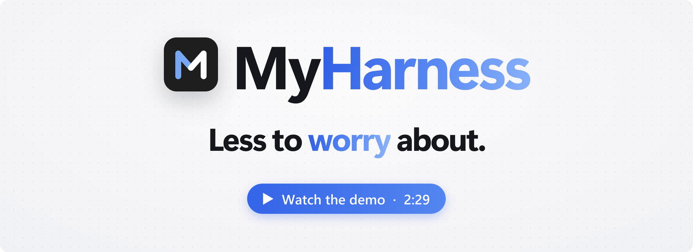
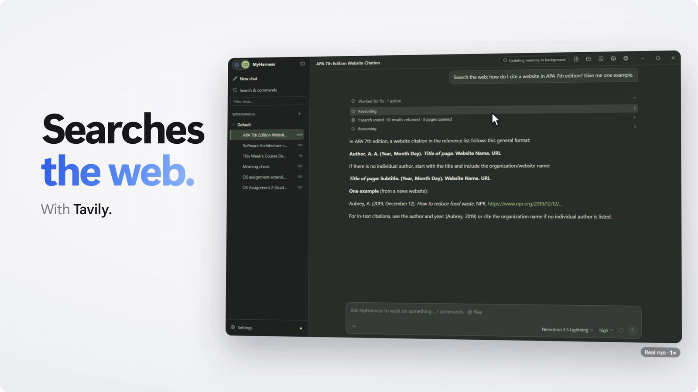
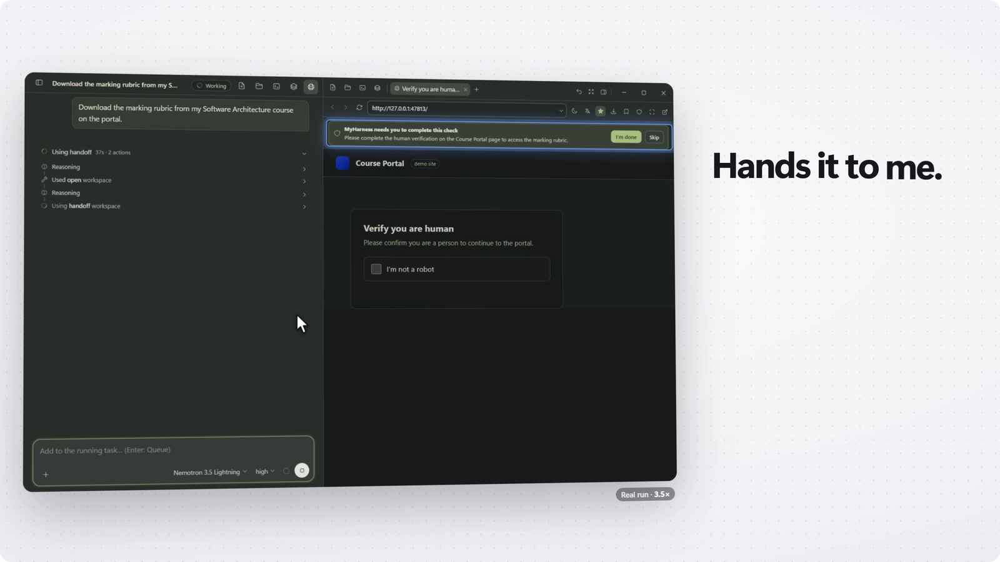
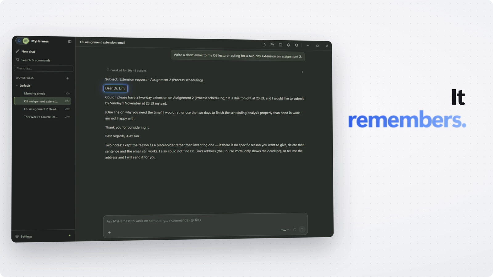
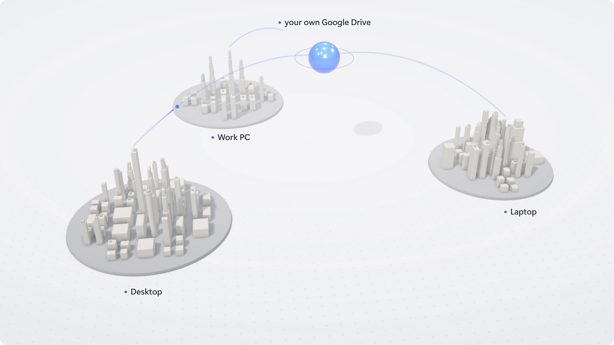
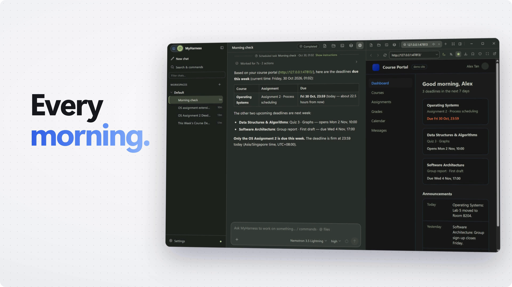
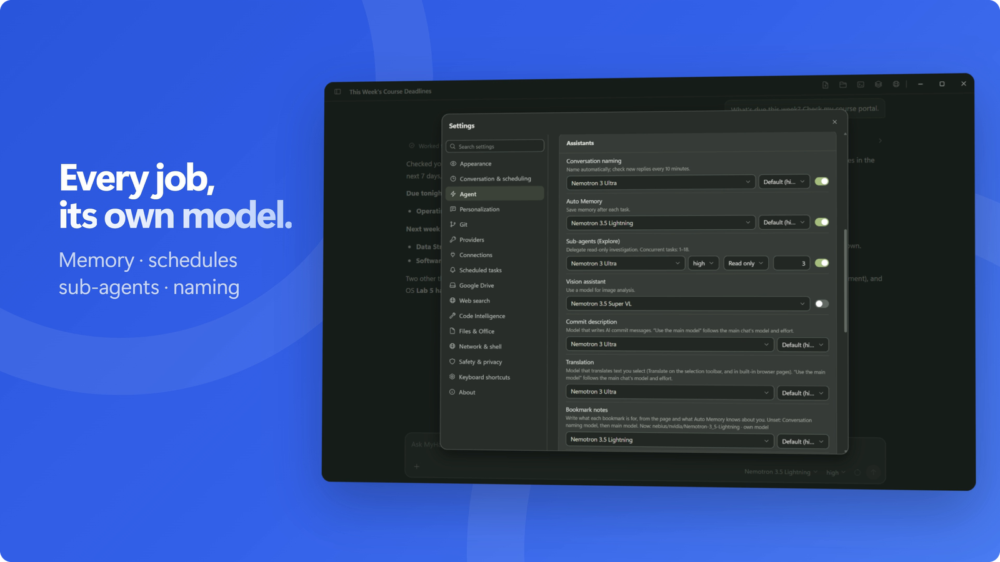
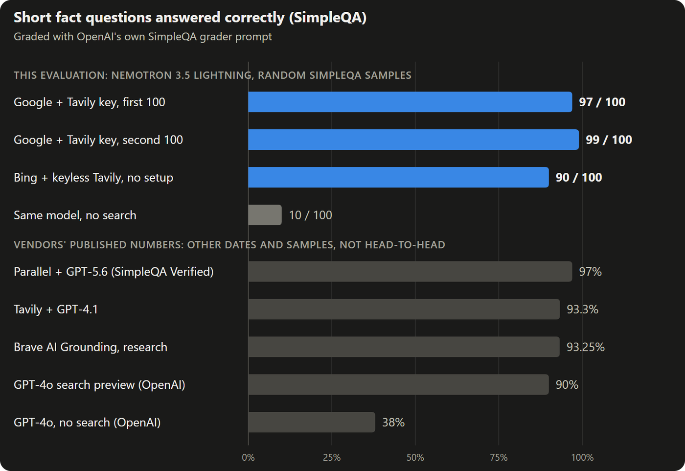
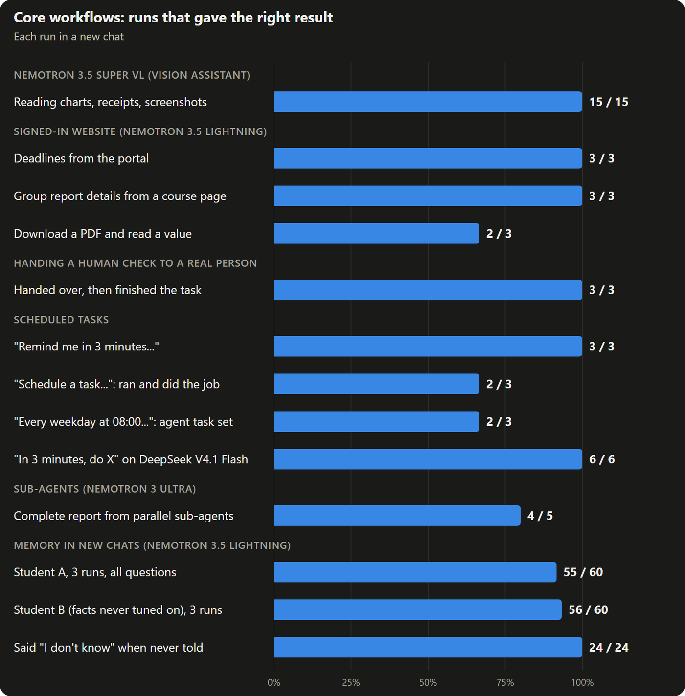

<p align="right"><a href="README.md">English</a> | <a href="README.zh-CN.md">简体中文</a></p>

<p align="center">
  <a href="https://youtu.be/0QUhR5p5z0c"></a>
</p>

<p align="center">
  MyHarness 是装在你自己 Windows 电脑上的个人 AI，在你已经登录的网站里直接干活，记得你在意的事，聊天和定时任务在你的几台电脑之间同步，写代码也照样能做。装好就能用 Nebius Token Factory 上的 NVIDIA Nemotron 和 DeepSeek V4.1 Flash：粘贴一个 API Key，每项工作都配好模型。
</p>

<p align="center">
  <a href="https://github.com/h3327725338-star/MyHarness/releases/latest"></a>
  <a href="https://youtu.be/0QUhR5p5z0c"></a>
  <a href="docs/evaluation/README.md"></a>
  <a href="docs/JUDGE_TESTING.md"></a>
</p>

<p align="center">
  <a href="LICENSE"></a>
  &nbsp;·&nbsp; <a href="docs/JUDGE_TESTING.md#known-limitations">已知限制</a>
</p>

<p align="center"><strong>真实运行的测量结果（主对话用 NVIDIA Nemotron 3.5 Lightning）。</strong><a href="docs/evaluation/README.md">方法、每一次失败和复现方式（英文）</a>。</p>

<table>
  <tr>
    <td align="center" valign="top" width="25%"><h3>196 / 200</h3>联网搜索（Google + Tavily）答对的随机 SimpleQA 题</td>
    <td align="center" valign="top" width="25%"><h3>111 / 120</h3>记忆测试在全新对话里答对的题</td>
    <td align="center" valign="top" width="25%"><h3>8 / 9</h3>在已登录网站上完成的任务</td>
    <td align="center" valign="top" width="25%"><h3>15 / 15</h3>通过 Nemotron 3.5 Super VL 看图答对的题</td>
  </tr>
</table>

## 为什么做 MyHarness

AI 助手已经很聪明了，可日常用起来，跑腿的活还是落在你身上。MyHarness 就是为了补上这些缺口：

- **碰不到真实的网页。** 问它某个网页，很多助手会说打不开，或者只凭几条搜索摘要回答；真正把来源读一遍的大范围搜索很少见。*MyHarness 会用多个搜索引擎搜索、读完整的网页，被拦住的网页改用真正的浏览器打开。*
- **用不了你的账号。** 课程门户、邮箱、GitHub、云控制台都在登录之后，而把密码交给 Agent 是不可能的。*MyHarness 在你已经登录的浏览器里干活。已保存的密码由应用自己填，不会交给模型；需要登录和人机验证时交还给你。*
- **你不开口它就不动。** 早上 8 点什么都不会发生，除非你打开对话打字。*MyHarness 按时运行提醒、Agent 任务和邮件，最小化到托盘也照样运行，还可以开机自启动。*
- **换台电脑就不认识你。** 历史和上下文只留在一台电脑或一个账号里；从家里的台式机换到随身的笔记本，一切从零开始。*MyHarness 通过你自己的 Google Drive 同步记忆、日常聊天、定时任务、书签和提示词。*
- **一个助手配不了所有场景。** 一门课、一份工作、一个副业项目，各自需要自己的指令、记忆和资料，可大多数助手最多给你一个全局提示词。*MyHarness 给生活的每一块一个工作区，各有自己的指令、记忆和资料库。*
- **长任务做着做着就散了。** 长对话会撑爆上下文，上周定好的事不重新贴一遍就没了。*MyHarness 会压缩长对话，带着交接摘要在新对话里继续，需要时还会去查你以前的聊天。*
- **小地方手感差。** 引用回答里的一段接着问、翻译一个词或一句话、回到你引用的那一句，步骤都比应有的多。*在 MyHarness 里选中文字就能引用或就地翻译，引用点一下就跳回原文。*
- **数据放在别人的服务器上。** 聊天、记忆和 Key 都存在一个你管不了的云端。*MyHarness 把它们留在你的电脑上，没有 MyHarness 服务器；开了同步的话，副本存在你自己的 Google Drive。*

MyHarness 起初是一名计算机专业学生为解决这些问题给自己做的，围绕的是真实的一周：课程门户、截止日期和两台电脑。

## 它能做什么

### 在真实网页中工作


<table>
  <tr>
    <td></td>
    <td></td>
  </tr>
</table>

<details>
<summary>在你已登录的网站里办事 · 看得懂的书签 · 读真实网页，不只看摘要 · 该你出手时它会停下</summary>

- **在你已登录的网站里办事。** 内置一个真正的 Chromium 浏览器，只用一个持久的配置，重启后登录还在。Agent 会开自己的后台标签页，读整页内容、点击、输入、下载文件，你在自己的标签里照常浏览。
- **看得懂的书签。** 每个书签都带一句“你用这个网站做什么”，可以自己写，也可以让辅助模型写。说一句“看看这周有什么要交”，它就会去对的门户，不用你报网址。
- **读真实网页，不只看摘要。** 网页搜索用 Tavily（不用 Key）和 Google，搜完会读排名靠前的几个网页的正文。网站或搜索引擎拦住普通请求时，MyHarness 会改用真正的浏览器打开，而不是直接放弃。
- **该你出手时它会停下。** 已保存的密码由应用自己填，不会交给模型。网页需要你登录或做人机验证时，那个标签上会出现一条请求，Agent 等着，你弄完它再接着做。在验证码和机器人检测页面上，它的点击和输入会被直接拒绝。

</details>

### 记忆与用户画像



<details>
<summary>三层记忆 · 不用吩咐也会记 · 构建你的用户画像 · 自动整理 · 按预算召回</summary>

- **三层记忆。** 全局记忆到哪儿都带着，每个工作区有自己的记忆，每个对话也有自己的笔记，所以一门课的细节不会混进另一门课的对话里。
- **不用吩咐也会记。** 每个任务结束后，自动记忆会挑出值得留下的内容，存进对应的那一层。你也随时可以说“记住这个”或“忘掉那个”。
- **构建你的用户画像。** 常驻用户画像从你的对话中逐渐形成，每一轮都会带上，所以助手从第一句话起就了解你的目标、习惯和偏好。
- **自动整理。** MyHarness 在后台合并相关的记忆，遇到矛盾以较新的事实为准，被替换的旧版本都保存在归档里，不需要你逐条确认。
- **按预算召回。** 每一轮都在固定预算内召回记忆，画像再大也不会挤掉对话本身。

</details>

### 互相关联的对话

<details>
<summary>多个对话同时运行 · 对话之间互相知道 · 长任务不会中断 · 回退或分叉 · 运行中也能插话 · 查找与保存</summary>

- **多个对话同时运行。** 几个对话可以同时进行、互不阻塞，各自有自己的任务和工具。
- **对话之间互相知道。** 问题涉及以前的对话时，助手会自己去查，并在回答里链接回它用到的那条消息。
- **长任务不会中断。** 长对话会自动压缩，保持在上下文窗口以内；任何对话都可以带着交接摘要在新对话里继续。
- **回退或分叉。** 可以回退到任意一条消息，或者从那条消息分叉出一个新对话，原对话保持不变。
- **运行中也能插话。** 任务运行时发消息，可以当场引导它，也可以排队作为下一步。
- **查找与保存。** 搜索和筛选对话，归档旧对话，还能把一个对话导出成独立的 HTML 页面。

</details>

### 工作区与个性化



<details>
<summary>生活的每一块都有自己的工作区 · 你自己的提示词 · 跟着你到其他电脑</summary>

- **生活的每一块都有自己的工作区。** General 模式的工作区（比如每门课、每个项目各一个）有各自的指令、记忆和资料库。
- **你自己的提示词。** 每种模式一份个人提示词，一份可在任何对话里复用的常用提示词，另外还有 skills 和提示词模板可以扩展。
- **跟着你到其他电脑。** 各层记忆、用户画像、日常（General 模式）聊天及其分支、定时任务、书签、提示词和草稿，都通过你自己的 Google Drive 同步；两台电脑上的修改会合并，而不是互相覆盖。

</details>

### 按计划自动运行



<details>
<summary>按时运行 · 及时通知 · 处理邮件和 GitHub</summary>

- **按时运行。** 提醒、Agent 任务（“每个工作日 8:00 看看我的门户和邮箱，记下新的截止日期”）和准点发出的邮件。MyHarness 开着就会运行，最小化到托盘也照样运行，还可以开机自启动。
- **及时通知。** 任务开始、完成或失败都会弹卡片；你在别的窗口时，还有系统通知和可选的提示音。
- **处理邮件和 GitHub。** Gmail 和 Outlook，走它们的 API，或者走你已经登录的网页邮箱；GitHub 直接用你电脑上已有的登录。

</details>

### 多智能体并行

- **子智能体分工。** 做调研或其他大任务时，助手会把任务拆给并行运行的子智能体（默认用 Nemotron 3 Ultra），你可以单独停止其中任何一个。更长的任务用分阶段的工作流一步步完成。

### 日常使用体验

<details>
<summary>划选引用 · 划词翻译 · 识图与文件预览 · 浏览器优先 · 按你的习惯来</summary>

- **划选引用。** 在回答里选中任意一段就能引用到下一条消息；已发消息里的引用点一下就跳回原文。
- **划词翻译。** 在对话、文件或面板里选中文字，翻译卡片就地出现；单个单词还会给出词条，带英式和美式发音。
- **识图与文件预览。** 可以直接拖入文件和图片；图片交给视觉模型读，PDF 和图片在对话旁边的侧面板里打开。
- **浏览器优先。** 浏览器全屏时，对话就在屏幕边缘一碰就出；网站跟着应用的深色模式走，每个网站记住自己的缩放。
- **按你的习惯来。** 三套配色主题，中英文界面，常用操作都有快捷键。

</details>

### 模型与数据

- **每项工作配自己的模型。** 子智能体、记忆、对话命名、翻译、识图、定时任务等辅助工作，都可以各自设置模型和思考强度，一个 Nebius Token Factory Key 就能全部配好。
- **数据留在你的电脑上。** 界面只监听 `127.0.0.1`。聊天、记忆、设置和 Key 都在 `%USERPROFILE%\.myharness`（从源码 checkout 运行时，聊天和记忆放在该 checkout 的 `data` 文件夹里），没有 MyHarness 服务器。模型请求只发给你选的 Provider（默认 Nebius Token Factory），同步走你自己的 Google Drive。同步没有端到端加密，只有浏览器的登录数据会在上传前用你的口令加密。

### 同样支持编程

- **Coding 模式**在代码仓库里工作，有 Git、worktree、按轮次查看改动和子智能体。

> 当前状态：在 Windows x64 上可用，桌面端和源码 checkout 两条路径都维护。Nebius Token Factory 已经内置（设置 → Providers → **Nebius Token Factory**：粘贴 Key，DeepSeek V4.1 Flash 和 Nemotron 模型按分工自动配好）；其他兼容 OpenAI、Anthropic、Gemini 或 Mistral 的 Provider 可以手动添加。已经验证过的边界写在 [PROJECT_STATUS.md](PROJECT_STATUS.md)。

## NVIDIA Nemotron on Nebius Token Factory



*设置 → 智能体。每项工作都可以换模型，默认分工见下表。*

内置的模型后端是 **[Nebius Token Factory](https://api.tokenfactory.nebius.com/v1/)**，提供 **NVIDIA Nemotron** 和 DeepSeek V4.1 Flash。设置 → Providers 一打开就是 **Nebius Token Factory**。点 **获取 API Key** 会在内置浏览器里打开 Token Factory 控制台；粘贴到网页上方细栏（或设置里）的 Key 会先读取账户的模型列表确认可用，再作为普通的 `openai-completions` Provider 写入 `models.json`，所有还没有自己模型的工作都会配上对应的模型：

| 模型 | 负责 |
|------|------|
| DeepSeek V4.1 Flash 1017 | 主模型、提交说明（账户没有 DeepSeek 时由 Ultra 接手） |
| Nemotron 3 Ultra | 子智能体、对话命名、翻译 |
| Nemotron 3.5 Lightning | 压缩上下文、备用模型、自动记忆、交接摘要、书签用途、定时任务、工作副本命名、分支摘要 |
| Nemotron 3.5 Super VL | 视觉助手（识图） |

**为什么选 Token Factory。** Nebius Token Factory 很适合做个人助手的底座。一个兼容 OpenAI 的接口提供大量开源模型，一个 Key 就能给每项工作挑出性价比最高、最合适的模型，而每个 NVIDIA 模型都有自己最能发挥的位置：

- **Nemotron 3 Ultra，负责深度思考：** 跑做调研、并行干活的子智能体，也负责对话命名和翻译。
- **Nemotron 3.5 Lightning，负责快手活：** 承担一整天都在跑的大量零碎后台工作（记忆、定时任务、书签用途、摘要和压缩上下文）。
- **Nemotron 3.5 Super VL，负责看：** 读截图和图片，把看到的内容报告给主模型。
- **长任务放得下：** 每个内置模型的上下文窗口都约有一百万 token，请求和其他 Provider 走同一条兼容 OpenAI 的路径。

主对话用 DeepSeek V4.1 Flash，因为测试中 Nemotron 模型当主智能体时调用工具有问题。不过它们响应快，正适合交给它们的子智能体、命名、翻译、后台工作和识图。主模型、子智能体和提交说明会设成所用模型最高的思考强度（DeepSeek 是 max，Ultra 是高）。每个 Nemotron 模型只提供 NVIDIA 为它写明的思考档位：Ultra 有关闭、中、高三档，Lightning 只有关闭和高；DeepSeek 有关闭、低、高和 max。

Token Factory 没有余额查询接口，所以 Nebius 卡片提供控制台链接（查看余额、充值），显示这台电脑按模型标价估算的花费；请求因余额问题被拒（HTTP 402 或错误信息提到余额）时会明确说明是余额问题。


<details>
<summary>Model ID、上下文窗口和不用界面的配置方法</summary>

| Model ID | 上下文 | 最大输出 | 由谁添加 |
|----------|--------|----------|----------|
| `deepseek-ai/DeepSeek-V4.1-Flash-1017` | 1,048,576 | 未公布（设为 65,536） | 内置配置和示例文件 |
| `nvidia/Nemotron-3-Ultra-550b-a55b` | 1,048,576 | 65,536 | 内置配置和示例文件 |
| `nvidia/Nemotron-3_5-Lightning` | 1,048,576 | 65,536 | 内置配置和示例文件 |
| `nvidia/Nemotron-3.5-Super-VL` | 1,048,576 | 未公布（设为 4,096） | 内置配置和示例文件 |
| `nvidia/nemotron-3-super-120b-a12b` | 262,144 | 65,536 | 只在示例文件里 |

内置配置按账户模型列表里的写法取用每个 ID。旧版本还会添加 Nemotron 3 Nano 负责命名和翻译，现在改由 Ultra 负责，已经添加过的 Nano 保持不动。DeepSeek V4.1 Flash 1017 和 Super-VL 能接图像；视觉助手开着时（默认开启），图片交给 Super-VL，主模型收到它的识图报告。Nemotron 的文本模型都是纯文本。2026-10-25 实测：一张含随机字符串、红色圆形和蓝色矩形的生成图片，约 1.3 秒被正确读出。给它留几千个输出 token——它先推理再回答。


不用界面的话，同一个 Provider 也可以用一个文件配好：

```powershell
# 1. 复制现成的 Provider 配置
Copy-Item packages\coding-agent\docs\examples\nebius-models.json "$env:USERPROFILE\.myharness\agent\models.json"

# 2. 通过环境变量提供 Token Factory key
$env:NEBIUS_TOKEN_FACTORY_API_KEY = "<your-token-factory-key>"

# 3. 启动后在 /model 里选择 “Nemotron 3 Ultra”
.\dev-desktop.cmd
```

也可以在设置 → **Providers** → **添加 Provider** 中手动创建：Base URL 填 `https://api.tokenfactory.nebius.com/v1/`，API type 选 OpenAI Chat Completions。示例里的纯文本模型声明 `text` 输入，只提供各自写明的 thinking 档位，通过 `reasoning_effort` 发送（Ultra：off / medium / high；Super：off / low / high；Lightning：off / high；`off` 发送为 `none`）；Super-VL 声明 `text` 和 `image` 输入，不发送 `reasoning_effort`，始终会推理。

</details>

- 完整配置、验证步骤和限制：[NVIDIA Nemotron on Nebius Token Factory](packages/coding-agent/docs/nebius-token-factory.md)。
- 可直接复制的配置：[`examples/nebius-models.json`](packages/coding-agent/docs/examples/nebius-models.json)。

## 记忆、用户画像与多端同步

- 常驻用户画像（`global/用户画像`）每一轮都发送，不参与“是否命中本轮问题”的排序；召回预算分层（画像位、目录位、动态卡片位），画像再大也挤不掉其它上下文。
- 三层记忆（全局、工作区、会话）加归档和待确认区，配套 search / read / write / delete / claim 工具。后台维护会把新材料压进画像、合并相近条目，不需要逐条确认。
- 直连 Google Drive API 同步：全部记忆层（含归档、待确认条目、画像）、General 模式的工作区与聊天（含分支和交接摘要）、会话附件与产物、资料库、草稿、General 模式的个性提示词、我的提示词、定时任务，以及内置浏览器的书签、新标签页快捷方式和网站设置；浏览器的登录状态和已存密码只有设置了同步口令才会同步，上传前先在本机用口令加密。
- 不同步：API key、OAuth token、信任决定、工具权限、锁、运行中的任务、Coding 模式的聊天与仓库，以及其它 Web 偏好。
- 合并用的是稳定 key 加按设备的版本向量：记忆按与双方最后一致版本的差异做三方合并，聊天按 entry id 合并所以两条分支都保留，合不了的冲突保留本地版本、把对方存成可恢复副本并列在设置里。Drive 传来的数据不能授予项目信任、不能执行命令。
- 边界：同步直连 Google Drive API。除了用内存传输的自动化测试，维护者也已在至少四台真实电脑之间实际跑过。退出应用后同步停止，除了浏览器加密的登录数据外没有端到端加密。详见 [Google Drive sync](packages/coding-agent/docs/google-drive-sync.md)。

## Quick Start（Windows）

**安装包。** 在 [Releases](https://github.com/h3327725338-star/MyHarness/releases) 页面的 MyHarness 版本里下载 `MyHarness-Setup-<版本号>.exe` 并运行。
- 安装包没有代码签名，SmartScreen 会先拦一下：点 **更多信息**，再点 **仍要运行**。
- 选 **仅为我安装** 就不需要管理员权限。
- 卸载后，`%USERPROFILE%\.myharness` 里的数据会保留。

**从源码运行。** 环境要求：

- Windows 10 或 11，x64；
- Node.js `>=22.19.0`；
- 如果要在 Windows 使用 `bash` tool，需要安装 Git for Windows；
- 一个模型 Provider 的 Key：Nebius Token Factory 已内置，其他 Provider 可以手动添加。

```powershell
git clone https://github.com/h3327725338-star/MyHarness.git
cd MyHarness
npm.cmd install --ignore-scripts
npm.cmd run build
.\dev-desktop.cmd
```

`dev-desktop.cmd` 会构建并启动 Electron 桌面端，这是日常使用 MyHarness 的方式。需要在命令行直接跑源码时，在仓库根目录执行 `node --import ./scripts/dev-fast-loader.mjs ./packages/coding-agent/src/web.ts`；它不会打开浏览器，会在日志中打印实际地址 `MyHarness Web UI: <url>`。

启动后，开始页面会链接到内置的 Nebius Token Factory 配置（设置 → Providers）。在那里粘贴 Token Factory 的 Key，DeepSeek V4.1 Flash 和 Nemotron 模型就配好了。其他 Provider 的说明见 [Providers](packages/coding-agent/docs/providers.md) 和 [Settings](packages/coding-agent/docs/settings.md)。

没有 Provider 凭据时，可以先检查 Web 源码入口是否能够启动：

```powershell
node --import ./scripts/dev-fast-loader.mjs ./packages/coding-agent/src/web.ts --help
```

这个 smoke check 不能证明外部 Provider、OAuth flow、Web Search service 或真实 model conversation 已经成功。

## 评估本项目

[评测：NVIDIA Nemotron 上的真实运行（英文）](docs/evaluation/README.md) 记录了 MyHarness 在联网搜索、已登录网站任务、人工验证交接、记忆、看图、子智能体和定时任务上的实际表现：测试方法、每一次失败及原因、按标价算的费用，以及复现脚本。

<p align="center">
  
</p>

<p align="center">
  
</p>

[Judge testing guide](docs/JUDGE_TESTING.md) 写了“安装或从源码构建”、如何挂上 Nebius Token Factory 凭据、五分钟测试脚本、源码该看哪里，以及已知限制。

## 给开发者

底层是一个 Electron 外壳，启动只监听本机（`127.0.0.1`）的 Web UI 和同一套后端，把模型 Provider 与你的文件、Shell 命令、内置浏览器、工具和可恢复 Session 连在一起。

<details>
<summary>架构和功能细节</summary>

- **代码协作**：Coding Agent 产品层提供文件、Shell、PowerShell、编辑、写入、Symbols、Git 和 GitHub 工作流。
- **入口**：本机浏览器 **Web UI**（`myharness`，只监听 loopback），并打包为 Windows 桌面应用；同时提供 Node.js SDK 供进程内集成。终端 TUI、Print 和 JSON 用户模式已移除，Web Terminal 面板保留。
- **对话与改动**：可恢复 Session、按轮次查看改动、分支摘要，以及长会话的 context compaction。
- **项目上下文**：project trust、`AGENTS.md` / `CLAUDE.md` context files、Workspace 与 Session 管理、Git 集成。
- **可扩展**：TypeScript extensions、skills、prompt templates、themes、custom Provider 和 MyHarness packages。
- **Code Intelligence**：通过可选的 Windows language-server 模块按语言提供 Symbols 语义导航。`symbols` 工具默认关闭，可用 `codeIntelligence.symbolsEnabled` 启用，修改后需重启生效。
- **双模式、同一后端**：Coding 模式在代码仓库里工作；General 模式处理查资料、写作和日常任务，带工作区指令、工作区记忆与资料库。聊天列表、草稿和配色按模式各自保存。
- **agent 能驱动的内置浏览器**：右侧面板是真实 Chromium 标签（桌面端为 `WebContentsView`，共用一个持久分区，重启后登录态还在）；`workspace` 工具可以导航、点击、打字、读页面或无障碍树、执行页面脚本、截图、下载文件、查看网络请求。
- **多智能体协作**：`agent`（前台与后台批次）、`workflow`（分阶段）、`ultracode`（多轮覆盖）三种派发，配三层活动条、可单独/全部停止和明确的结束状态；主 agent 可用 `agent_tasks` 列出并停止自己的派发。
- **逐角色绑模型**：主模型在输入框的模型菜单里选；设置 → 智能体里给每个辅助角色单独选 Provider、模型和思考档位——子智能体、Auto Memory、对话命名、压缩、分支摘要、交接摘要、提交描述、副本命名、翻译、视觉分析，以及备用模型。选“使用主模型”的角色跟随主对话的模型和思考档位；备用模型选它表示不启用备用。
- **网页搜索默认打开**：Tavily + Google。没填 Key 时 Tavily 走它的免费免 Key 通道（由 Tavily 限速）；设置 → 网页搜索里有 **获取免费 Key** 的链接，免费 Key 每月 1000 次。Bing、DuckDuckGo、Brave 可以另外加上，轻量请求被拦截的引擎会改用浏览器。
- **可选能力**：TypeScript extensions、skills 和 prompt templates。

</details>

源码和状态文档会把“已经实现的 contract”“已经加载的运行时配置”和“依赖机器或凭据的验证结果”分开记录。

## 文档

- [Coding Agent 文档索引](packages/coding-agent/docs/index.md)
- [Coding Agent 中文文档索引](packages/coding-agent/docs/index.zh-CN.md)
- [Quickstart](packages/coding-agent/docs/quickstart.md)
- [使用说明与 Web 启动](packages/coding-agent/docs/usage.md)
- [Provider 与 model](packages/coding-agent/docs/providers.md)
- [NVIDIA Nemotron on Nebius Token Factory](packages/coding-agent/docs/nebius-token-factory.md)
- [Google Drive sync](packages/coding-agent/docs/google-drive-sync.md)
- [Windows 设置](packages/coding-agent/docs/windows.md)
- [当前项目状态与验证边界](PROJECT_STATUS.md)
- [架构与开发维护手册](ARCHITECTURE_AND_DEVELOPMENT.md)
- [开发指南](packages/coding-agent/docs/development.md)
- [源码模块地图](packages/coding-agent/docs/source-modules.md)
- [存储与数据边界](docs/STORAGE.md)
- [维护手册](MAINTENANCE.md)
- [GitHub 自动化](docs/maintenance/github-automation.md)
- [贡献指南](CONTRIBUTING.zh-CN.md)
- [安全策略](SECURITY.md)
- [完整文档总索引](DOCUMENTATION_INDEX.md)
- [English README](README.md)

## 开发与贡献

在仓库根目录执行常用检查：

```powershell
npm.cmd run check
npm.cmd test
npm.cmd run audit:release
```

`npm.cmd run check` 会以可写模式运行 Biome，可能改写格式化文件。检查范围、发布/隐私边界和 Pull Request 要求见[贡献指南](CONTRIBUTING.zh-CN.md)。

## 致谢

MyHarness 最初 fork 自 Mario Zechner 的 [pi-mono](https://github.com/badlogic/pi-mono)（MIT 协议），之后经过大量重写和扩展。原项目许可证见 [THIRD_PARTY_NOTICES.md](THIRD_PARTY_NOTICES.md)。

## License

MyHarness 自有代码使用 [Apache License 2.0](LICENSE)。继承代码和第三方组件继续保留各自的 license、copyright 和 attribution，详见 [NOTICE](NOTICE) 与 [THIRD_PARTY_NOTICES.md](THIRD_PARTY_NOTICES.md)。
